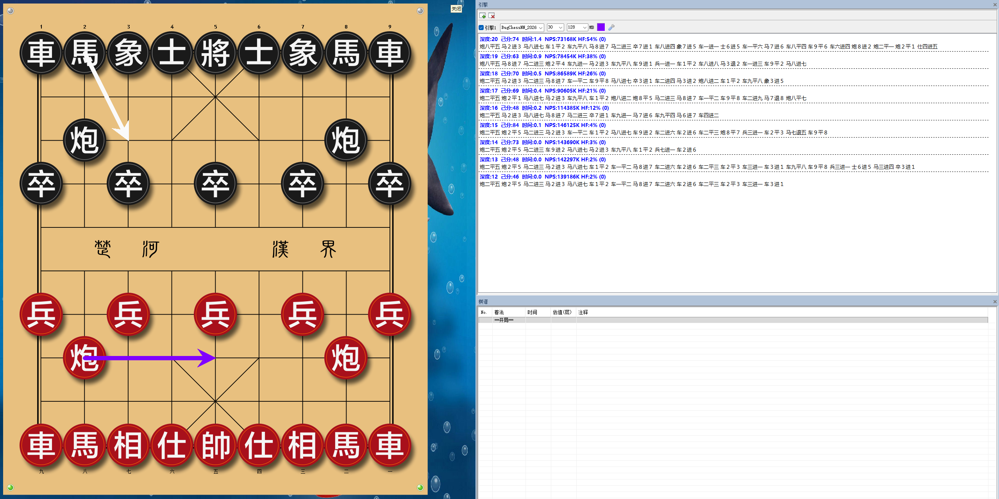
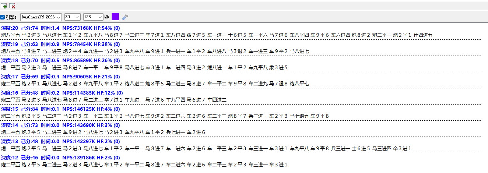

# 小虫引擎破解器

适配 **小虫引擎 20260627**，提供 SSE4、AVX2、BMI2、AVX512 四个版本的原 EXE 接入。组件安装一次后，在鲨鱼等棋盘里直接选择原引擎文件，协议使用 **UCI**，无需常开破解器。

**可以使用与小虫引擎兼容的审局库（残局库）**，通过 `settings.txt` 的 `EgtbEnable` 和 `EgtbPath` 配置。审局库数据需自行准备，发布包不包含审局库。

项目地址：[tippingabke-gif](https://github.com/tippingabke-gif/bugchess-cracker) · 安装器版本 **1.0.0.220**

## 下载

| 文件 | 内容 | 适合谁 |
|---|---|---|
| [单独版](https://github.com/tippingabke-gif/bugchess-cracker/releases/download/v20260627-r1/BugChess-20260627-Standalone-v1.0.0.220.zip) | 单文件破解器、使用说明与许可声明 | 已有完整小虫原包和棋盘 |
| [鲨鱼整合包](https://github.com/tippingabke-gif/bugchess-cracker/releases/download/v20260627-r1/ChessShark-BugChess-20260627-v1.0.0.220.zip) | 鲨鱼、启动入口、四个小虫原引擎、权重、知识库、破解器与预置配置 | 希望解压后从统一入口启动 |

[全部下载与 SHA-256](https://github.com/tippingabke-gif/bugchess-cracker/releases/tag/v20260627-r1)

## 使用说明

### 鲨鱼整合包

1. 完整解压到固定、可写目录，例如 `D:\ChessTools`，所在盘建议预留至少 2 GB。
2. 双击根目录 **`启动鲨鱼.exe`**，接受管理员权限提示。首次启动会安装小虫组件，然后打开鲨鱼；请等待准备窗口结束。
3. 已预置 **BugChess SSE4**，点击放大镜开始计算。需要换版本时，先卸载当前引擎，再从 `小虫` 文件夹添加相应原 EXE，协议选 UCI。
4. 后续仍可使用同一启动入口；组件已安装时会先检查状态，再打开棋盘。

### 单独版

1. 将 `BugChessCracker.exe` 放进完整原包目录，与四个 `BugChessNN_20260627_release_*.exe`、`weights_20260627.bin`、`knowledge.bin`、`settings.txt` 同级。
2. 双击破解器并接受管理员权限提示，等待安装完成。
3. 在棋盘中添加该目录的原引擎 EXE，协议选 UCI。**不要把破解器添加为引擎。**
4. 保留生成的 `tippingabke-gif` 组件目录和 `account.txt`；以后直接加载原 EXE。

完整操作、升级、卸载和常见问题见 [使用说明](使用说明.md)。鲨鱼原程序在部分 VMware 环境会触发虚拟机检测提示，整合包未对所有虚拟机环境作兼容承诺。

## 使用截图

棋盘与引擎计算界面：



线程参数、深度、评分与 NPS 细节：



截图中的数值来自一次实际运行，性能会随 CPU、线程、局面和后台负载变化。

## 审局库配置

退出引擎后编辑引擎目录下的 `settings.txt`，例如：

```ini
EgtbEnable = true
EgtbPath = D:\ChessTables | 0
EgtbProbeDepth = 16
```

将示例路径替换为自己的兼容库目录，路径避免空格；`| 0` 表示固态硬盘，`| 1` 表示机械硬盘。多目录可按原配置格式每行写一个 `EgtbPath`，保存后重新加载引擎。实际查表还取决于库覆盖的局面，开局 `tbhits=0` 属于正常情况。

`weights_20260627.bin` 是神经网络权重，`knowledge.bin` 是知识库；两者与审局库是不同文件。使用截图展示了引擎计算，并非审局库命中证明。

## 版本与线程

| 原文件后缀 | 运行要求 |
|---|---|
| SSE4 | 支持相应 SSE4 指令的 x64 CPU，整合包默认选择 |
| AVX2 | CPU 与系统支持 AVX2 |
| BMI2 | CPU 支持 BMI2 及该构建需要的指令 |
| AVX512 | 当前组件使用指令模拟，加载时间和速度与原生版本不同 |

组件已移除临时 4 线程限制，默认线程数为 1，具体值在棋盘中设置。UCI 数值边界是 `1..2147483647`，这不是建议配置；按本机 CPU 与内存选择实际线程数。初次加载模型需等待，建议 SSE4/AVX2/BMI2 加载超时至少 30 秒，AVX512 至少 90 秒。

## 原理说明与源码

安装器校验原文件，为所选目录的原 EXE 建立精确路径启动接入，按需运行本地组件，完成初始化、权重加载和 UCI 输入输出转发。原 EXE 与权重文件保持原始字节。没有常驻系统服务或开机任务。完整细节见 [原理说明](原理说明.md)。

`src/` 提供本项目的安装器、接入组件和运行脚本源码；**不包含小虫或鲨鱼原程序源码**。鲨鱼启动器源码和第三方材料随整合包保留；构建范围见 [源码说明](src/README.md)。

本项目自有代码与文档采用 [MIT](LICENSE)。第三方程序、模型和库分别遵循各自条款，见 [第三方声明](THIRD_PARTY_NOTICES.md)。Actions 检查源码语法和编译；许可证及检查通过不等于恶意软件认证或所有设备兼容性保证。
